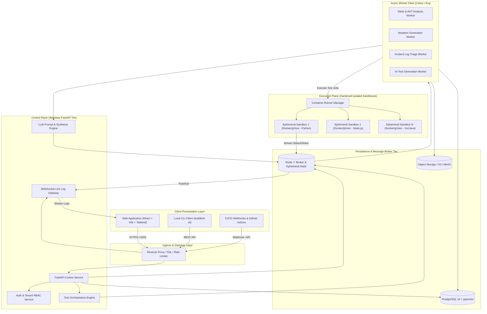
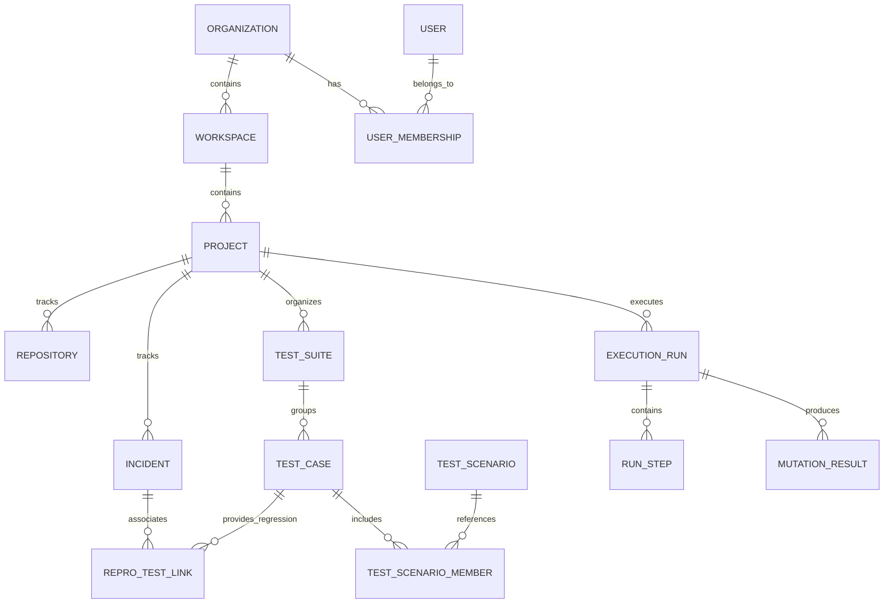

# TestBlind AI — Technical Architecture & System Design

**Document Version:** 1.0.0  
**Status:** Approved Architectural Baseline  
**Architecture Classification:** Distributed Event-Driven Microservices / Sandboxed SaaS  

---

## 1. System Overview & Architecture Topology

TestBlind AI is architected with strict separation between the **Control Plane** (user management, API, orchestrator, state storage) and the **Execution Plane** (isolated, untrusted runner containers). Under no circumstances is arbitrary user repository code or generated test suites executed inside the Control Plane.



---

## 2. Technology Stack & Component Justifications

| Tier | Selected Technology | Version | Architectural Justification |
| :--- | :--- | :--- | :--- |
| **Frontend Framework** | React + TypeScript + Vite | React 19, TS 5.4, Vite 5 | High performance, rapid hot-reloading, type safety, rich component ecosystem for developer tooling. |
| **Styling & Design System** | Tailwind CSS + Lucide Icons | Tailwind v3.4+, Lucide React | Implements custom Dark TraceAI Studio design tokens, high density, accessible, zero runtime CSS overhead. |
| **Code Editor** | Monaco Editor (`@monaco-editor/react`) | Latest | Production-grade IDE editor supporting syntax highlighting, side-by-side diffing, AST range markers, multi-language support. |
| **Data Visualizations** | Recharts / SVG Canvas | Latest | Renders stacked bar charts, donut gauges, sparklines, and execution timelines responsive to dark mode palette. |
| **Backend API** | Python + FastAPI | Python 3.12+, FastAPI 0.111+ | Native asynchronous ASGI performance, automatic OpenAPI 3.1 documentation, tight integration with Python AST/mutation engines and AI SDKs. |
| **Data Validation** | Pydantic v2 | v2.7+ | Ultra-fast Rust-based data validation and serialization for API contracts and LLM structured JSON output. |
| **Relational Database** | PostgreSQL + pgvector | PostgreSQL 16 | ACID transactions, robust JSONB querying for execution artifacts, relational integrity for multi-tenancy, vector similarity for incident logs. |
| **ORM & Migrations** | SQLAlchemy (Async) + Alembic | v2.0+, Alembic 1.13+ | Modern async session management with declarative mapped models and version-controlled database migrations. |
| **Cache & Task Broker** | Redis | Redis 7.2+ Alpine | High-throughput in-memory message broker for async task distribution, distributed locking, and WebSocket pub/sub streaming. |
| **Async Task Workers** | Celery / Arq | Celery 5.4+ / Arq | Distributed background task execution with automatic retries, concurrency limits, and scheduled heartbeat monitoring. |
| **Container Sandboxing** | Docker Engine API / gVisor | Docker 26+, runsc | Ephemeral runner containers with complete process, filesystem, and network isolation for executing untrusted user code. |
| **Object Storage** | MinIO (local dev) / AWS S3 (prod) | S3 API compatible | Scalable storage for raw repository ZIP archives, execution logs, and coverage reports. |

---

## 3. Sandboxed Untrusted Code Execution Engine

### 3.1 The Untrusted Execution Threat Model
Executing user repositories, external dependencies, and AI-generated test code introduces severe security risks:
1. Malicious dependency execution (e.g. `npm install` post-install scripts or `setup.py` hooks).
2. Host container breakout or Linux kernel privilege escalation.
3. Cryptomining or resource starvation (fork bombs, CPU loops, memory exhaustion).
4. SSRF attacks against internal infrastructure or cloud metadata endpoints (`169.254.169.254`).
5. Host filesystem compromise or lateral network movement.

### 3.2 Sandbox Hardening & Defense-in-Depth Specification
Every test run or mutation execution is encapsulated inside an ephemeral container configured with the following restrictions:

```
┌────────────────────────────────────────────────────────┐
│ Hardened Ephemeral Runner Container                     │
│ ┌────────────────────────────────────────────────────┐ │
│ │ Read-Only Root Filesystem (/): No persistent writes│ │
│ │ Dedicated Tmpfs (/tmp, /workspace): Max 100MB RAM  │ │
│ │ User Context: Non-root 'runner' (UID 10001, GID 10001)│
│ │ Dropped Capabilities: ALL capabilities dropped     │ │
│ │ Security Profile: seccomp=default, apparmor=docker-default
│ │ Runtime: runsc (gVisor) in production / isolated runc│
│ ├────────────────────────────────────────────────────┤ │
│ │ Network Isolation:                                 │ │
│ │   Mode: --network=none                             │ │
│ │   Optional Egress: Strictly via controlled egress  │ │
│ │   proxy with domain whitelist for dependency fetch │ │
│ ├────────────────────────────────────────────────────┤ │
│ │ Resource Quotas:                                   │ │
│ │   CPU Limit: 1.0 Core (cpus=1.0)                   │ │
│ │   Memory Limit: 1024MB (memory=1024m, swap=0)      │ │
│ │   PIDs Limit: 128 processes (pids-limit=128)       │ │
│ │   Execution Timeout: 60s hard kill via daemon      │ │
│ └────────────────────────────────────────────────────┘ │
└────────────────────────────────────────────────────────┘
```

### 3.3 Container Lifecycle Flow
1. **Runner Provisioning:** Worker requests a pre-warmed language-specific runner image (`testblind-runner-python:3.12`, `testblind-runner-node:20`).
2. **Mounting Ephemeral Context:** The tenant's code snapshot is mounted into a dedicated tmpfs scratch volume (`/workspace`) with read-write access restricted to the non-root runner user.
3. **Execution Command Injection:** The target execution command (e.g. `pytest --tb=short tests/test_generated_repro.py`) is invoked with strict timeout enforcement (`timeout 60s`).
4. **Log Interception & Streaming:** Stdout and Stderr are intercepted frame-by-frame, published to Redis Pub/Sub channels for live client WebSocket playback, and aggregated for analysis.
5. **Teardown & Purge:** Container is forcefully terminated (`docker rm -f`) and the temporary workspace directory is securely purged.

---

## 4. Database Schema & Entity Architecture



### 4.1 Core Entity Definitions
- **organizations:** Tenant root with enterprise licensing, billing, and global settings.
- **users & user_memberships:** User identities with RBAC roles (`owner`, `admin`, `engineer`, `viewer`).
- **projects:** Scoped project contexts containing repositories, suites, and execution runs.
- **repositories:** Metadata for connected GitHub repos (repo URL, default branch, webhook secret, token reference) or ZIP archive identifiers.
- **test_cases:** Atomic test definitions containing code, language, verification status (`AI_SUGGESTED`, `VERIFIED_EXECUTED`, `EXECUTION_FAILED`), mutation kill stats, and hash.
- **test_scenarios:** Ordered compositions of test cases mirroring end-to-end user flows or regression modules.
- **execution_runs:** Master records of run triggers (manual, scheduled, CI webhook, playground), trigger metadata, overall exit code, total duration, and summary stats.
- **run_steps:** Individual granular steps in a run (AST parse, mutation injection, test run) with exit codes, duration, and log references.
- **mutations:** Recorded AST mutations (file, line number, operator type, original token, mutated token, status: `KILLED`, `SURVIVED`, `TIMED_OUT`).
- **incidents:** Intake records for production failures (title, severity, raw stack trace, logs, faulting module, reproduction state).
- **ai_insights:** Machine-generated optimization recommendations, predicted flaky tests, and blindspot summaries.

---

## 5. AI Test Generation & Mutation Pipeline Architecture

### 5.1 AST Analysis Engine
- **Python:** Built using standard library `ast` module and `libcst` for concrete syntax tree modification and token preservation.
- **TypeScript/JavaScript:** Built using `@babel/parser`, `@babel/traverse`, and `@babel/generator`.
- Generates AST nodes, marks mutant targets, and outputs exact line/column offsets.

### 5.2 Mutation Testing Engine
- Operates in targeted batches to avoid combinatorial explosion.
- **Selective Mutation Sampling:** Prioritizes AST branches with high cyclomatic complexity and low test execution density.
- **Mutator Operators:**
  - `ROR` (Relational Operator Replacement): `<`, `<=`, `>`, `>=`, `==`, `!=`
  - `AOR` (Arithmetic Operator Replacement): `+`, `-`, `*`, `/`, `%`
  - `LCR` (Logical Connector Replacement): `and`, `or`, `not`
  - `UOI` (Unary Operator Insertion): `-x`, `~x`, `not x`
  - `BSR` (Block Statement Removal / Early Return): inserting `return None`, `return default`
  - `EIR` (Exception Inversion / Suppression): replacing specific catch blocks with re-raise or silent pass.

### 5.3 LLM Orchestration & Prompt Architecture
The AI Synthesis Engine interacts with LLM providers through a structured schema pipeline:

```
┌────────────────────────────────────────────────────────┐
│ Context Assembly:                                      │
│  - Target Source File & Line Range                     │
│  - Surviving Mutation / Incident Stacktrace            │
│  - Existing Passing Test Fixtures & Utilities          │
│  - Project Dependency Context                          │
└──────────────────────────┬─────────────────────────────┘
                           │
                           ▼
┌────────────────────────────────────────────────────────┐
│ LLM Provider Interface (JSON Structured Output):        │
│  - System Prompt: Testing Expert, Strict Isolation     │
│  - Schema: Pydantic TestSynthesisResponse              │
│    - test_code: string (executable unit test)          │
│    - test_name: string (naming convention)             │
│    - targeted_fault_description: string               │
│    - assertion_rationale: string                       │
│    - required_fixtures: array of strings               │
└──────────────────────────┬─────────────────────────────┘
                           │
                           ▼
┌────────────────────────────────────────────────────────┐
│ Static Syntax & Safety Filter:                         │
│  - Syntax validation via language parser               │
│  - Disallowed import scanner (no os.system, socket)    │
└──────────────────────────┬─────────────────────────────┘
                           │
                           ▼
┌────────────────────────────────────────────────────────┐
│ Dual-State Sandbox Execution Gate:                     │
│  - State A (Buggy/Mutant): Must FAIL                   │
│  - State B (Pristine/Fixed): Must PASS                 │
│  - Outcome: Promoted to VERIFIED or Marked FAILED      │
└────────────────────────────────────────────────────────┘
```

---

## 6. API Design & Communication Protocols

### 6.1 RESTful Control Plane (OpenAPI 3.1)
- `/api/v1/auth`: Login, registration, token refresh, OAuth callback.
- `/api/v1/organizations`: Organization settings, member management, invite tokens.
- `/api/v1/projects`: Project CRUD, repository linking, branch listings.
- `/api/v1/repositories/upload-zip`: Multipart ZIP archive upload endpoint.
- `/api/v1/playground/execute`: Ad-hoc code + test evaluation in sub-second sandbox.
- `/api/v1/mutation-runs`: Initiate AST analysis and mutation gap discovery.
- `/api/v1/incidents`: Submit incident reports, parse stack traces, trigger reproduction generation.
- `/api/v1/test-cases`: Query test library, filter by verified status, export test files.
- `/api/v1/dashboard/metrics`: Aggregated KPI counters, coverage ratios, weekly status bars.

### 6.2 Real-time WebSocket Protocol
- Route: `/ws/v1/runs/{run_id}/stream`
- Authentication: Short-lived WebSocket ticket exchange via HTTP query parameter.
- Message Format (JSON):
```json
{
  "event": "log_chunk",
  "data": {
    "step_id": "step_mut_04",
    "stream": "stdout",
    "timestamp": "2026-10-26T11:20:00.123Z",
    "text": "running pytest on mutated target: math_utils.py:42 [MUTANT: AOR_PLUS_TO_MINUS]... KILLED\n"
  }
}
```

---

## 7. Security, Compliance & Data Governance

1. **Multi-Tenant Isolation:**
   - Every database query enforces tenant isolation via SQLAlchemy query filters (`where organization_id == current_org`).
   - S3 storage buckets partition objects by `org_{id}/proj_{id}/`.
2. **Credential Storage:**
   - All external secrets (GitHub personal access tokens, webhook secrets, custom API keys) are encrypted using AES-256-GCM with envelope encryption via a master key rotation system.
3. **Audit Logging:**
   - All user actions (test execution, incident intake, member invitation, code download) are logged into an append-only audit trail table with actor ID, IP address, timestamp, and payload hash.
