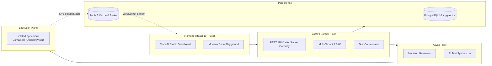

# TestBlind AI — AI-Powered Software Testing SaaS

[](https://github.com/organization/testblind-ai)
[](https://python.org)
[](https://fastapi.tiangolo.com)
[](https://react.dev)
[](https://docker.com)
[](#)

> **TestBlind AI** is a professional AI-native software testing SaaS designed to eliminate test blindspots and automate regression test synthesis. By integrating **AST-driven mutation testing**, **LLM-powered test generation**, **containerized isolated execution**, and **dual-state verification**, TestBlind AI delivers verified, executable regression tests that harden modern web and backend applications.

---

## Key Capabilities

### 1. AI Test Gap Discovery & Mutation Testing
- Synthesizes semantic mutations across relational, arithmetic, and logical operators in your source code.
- Executes your existing test suites inside isolated containers to detect surviving mutants.
- Leverages LLMs to generate targeted edge-case unit tests that kill surviving mutants and cover untested branches.
- Verifies synthesized tests against both mutated and pristine code before promoting them to the regression library.

### 2. Incident-to-Regression Test Generation
- Ingests production incident reports, stack traces, and failure logs.
- Automatically maps stack frames to source code AST anchors.
- Generates reproduction tests that recreate the exact defect conditions.
- Validates the reproduction test via **Dual-State Verification**: ensures the test fails with the matching incident signature on buggy code, and passes when the fix is applied.

### 3. Dark TraceAI Studio Dashboard
- Professional, high-density dark UI inspired by the TraceAI Studio design benchmark (`references/aitool.jpeg`).
- Real-time KPI metric cards (Test Cases Overview, Requirement Coverage, Test Scenarios Executed, AI-Driven Insights).
- Multi-week execution status stacked bar charts and requirement coverage donut graphs.
- Filterable recent test scenario tables with execution times, statuses, and AI confidence badges.

### 4. Standalone Code Playground & Input Modalities
- **Standalone Playground:** Instant multi-language Monaco code editor for testing snippets, injecting mutations, and verifying tests without connecting a repository.
- **GitHub App & OAuth:** Connect public or private repositories with branch and PR gating.
- **ZIP Archive Upload:** Drag-and-drop repository snapshots unpacked safely in tenant scratch volumes.
- **Local CLI (`testblind-cli`):** On-premise execution for enterprise organizations with strict code privacy requirements.

### 5. Sandboxed Untrusted Code Execution
- Zero user code or generated test suites execute within the API web process.
- Ephemeral, hardened Docker/gVisor runner containers with non-root execution (`uid=10001`), read-only root filesystems, `--network=none`, and strict CPU/memory quotas.

---

## System Architecture



---

## Canonical Project Documentation

| Document | Purpose & Canonical Scope |
| :--- | :--- |
| **[`product-spec.md`](./product-spec.md)** | Canonical product requirements, personas, workflows, functional modules, and NFRs. |
| **[`architecture.md`](./architecture.md)** | Detailed system architecture, data models, sandboxing security specifications, and API protocols. |
| **[`design.md`](./design.md)** | Design tokens, TraceAI Studio UI components, responsive layout, and WCAG accessibility standards. |
| **[`bugs.md`](./bugs.md)** | Architectural risk register, failure modes, verified bugs, and technical debt. |
| **[`deployment.md`](./deployment.md)** | Complete local setup, Docker Compose configuration, production deployment, and env variables. |
| **[`implementation-plan.md`](./implementation-plan.md)** | Phased engineering implementation roadmap and detailed acceptance criteria. |

---

## Quickstart (Local Development)

### Prerequisites
- Docker Engine 24+ & Docker Compose v2.20+
- Node.js v20+ & npm 10+
- Python 3.12+

### 1. Initialize Configuration
```bash
cp .env.example .env
```

### 2. Build Sandbox Runners
```bash
docker build -t testblind-runner-python:3.12 -f docker/runners/Dockerfile.python .
docker build -t testblind-runner-node:20 -f docker/runners/Dockerfile.node .
```

### 3. Launch Docker Compose Stack
```bash
docker compose up -d
```

### 4. Access Local Services
- **Web Application:** `http://localhost:3000`
- **FastAPI Control Plane & Swagger Docs:** `http://localhost:8000/docs`
- **MinIO Storage Console:** `http://localhost:9001` (User: `minio_admin_user`, Password: in `.env`)

---

## Repository Directory Structure

```
├── product-spec.md            # Canonical complete product requirements
├── architecture.md            # Technical architecture and decisions
├── design.md                  # Design system and UI/UX behavior
├── bugs.md                    # Verified bugs, risks, and technical debt
├── deployment.md              # Configuration, local setup, deployment, operations
├── readme.md                  # Project overview and developer instructions
├── implementation-plan.md     # Phased implementation and acceptance criteria
├── references/
│   └── aitool.jpeg            # Dark TraceAI Studio UI visual reference benchmark
├── docker/
│   ├── docker-compose.yml     # Multi-service dev topology
│   └── runners/               # Hardened ephemeral sandbox Dockerfiles
├── backend/                   # Python FastAPI ASGI Control Plane
│   ├── app/
│   │   ├── api/               # REST & WebSocket endpoints
│   │   ├── core/              # Config, security, database sessions
│   │   ├── models/            # SQLAlchemy database entities
│   │   ├── schemas/           # Pydantic v2 data transfer schemas
│   │   ├── services/          # AST analysis, mutation engine, LLM client
│   │   └── workers/           # Celery / Arq background worker tasks
│   ├── alembic/               # Database migrations
│   └── tests/                 # Backend automated test suite
├── frontend/                  # React 19 + TypeScript + Vite + Tailwind Web App
│   ├── src/
│   │   ├── components/        # TraceAI Studio dashboard, metric cards, charts
│   │   ├── pages/             # Dashboard, Test Cases, Playground, Incidents
│   │   ├── services/          # API & WebSocket client hooks
│   │   └── types/             # TypeScript domain schemas
└── cli/                       # testblind-cli local execution utility
```

---

## License & Legal

Copyright © 2026 TestBlind AI. All rights reserved. Proprietary software.
